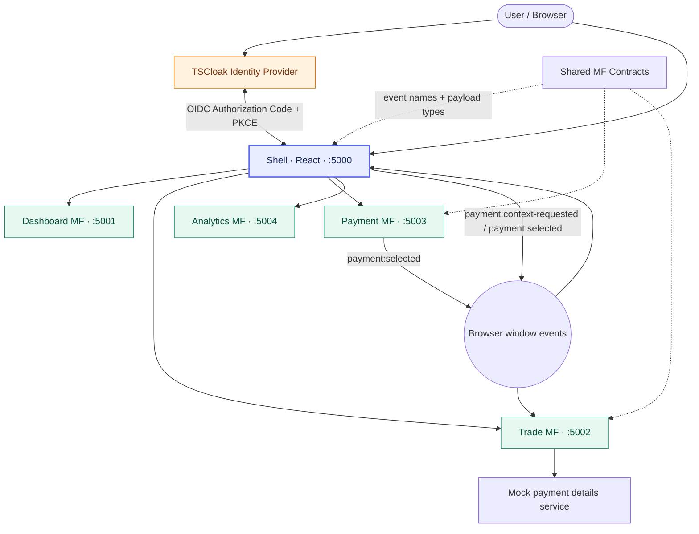
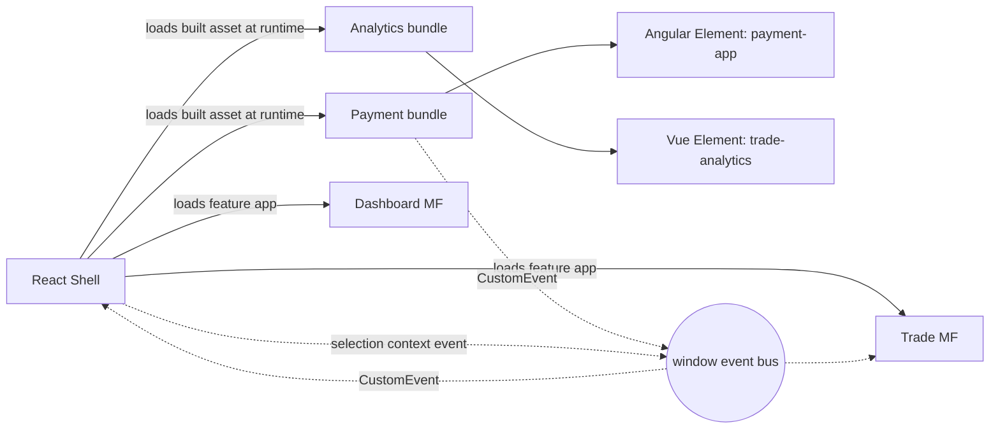
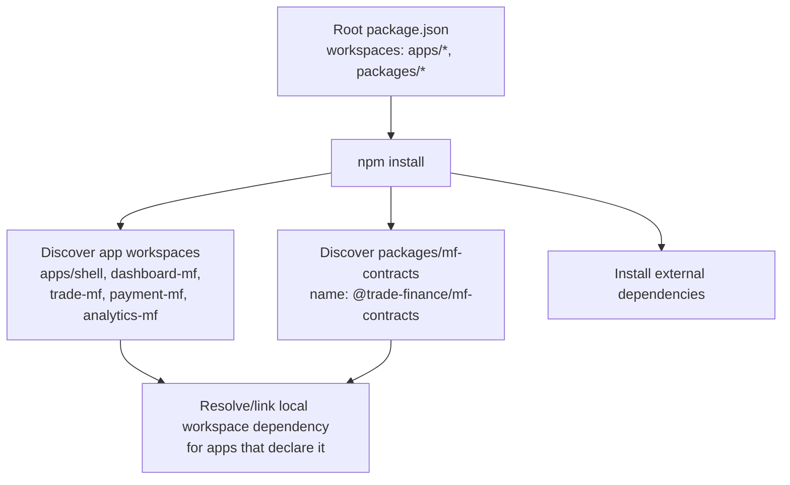
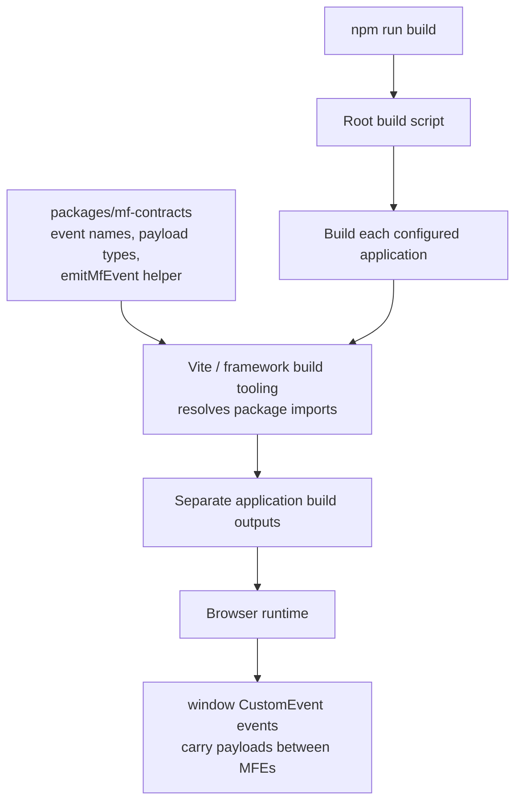
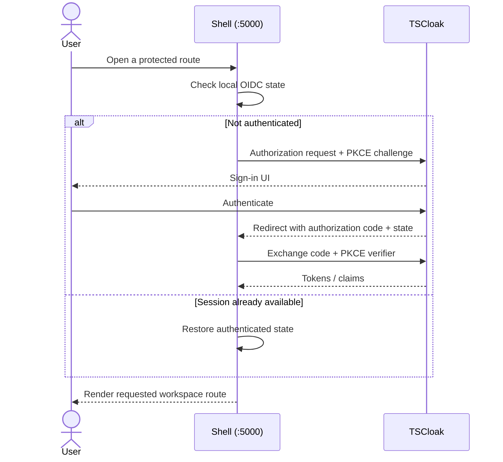
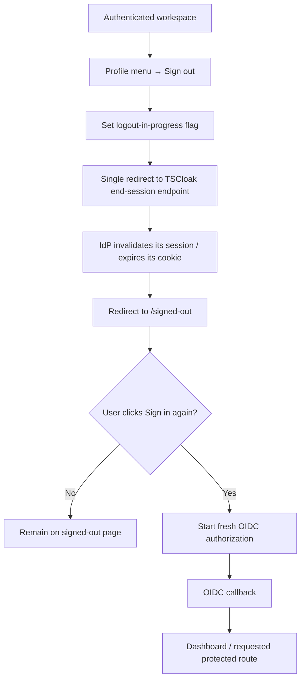
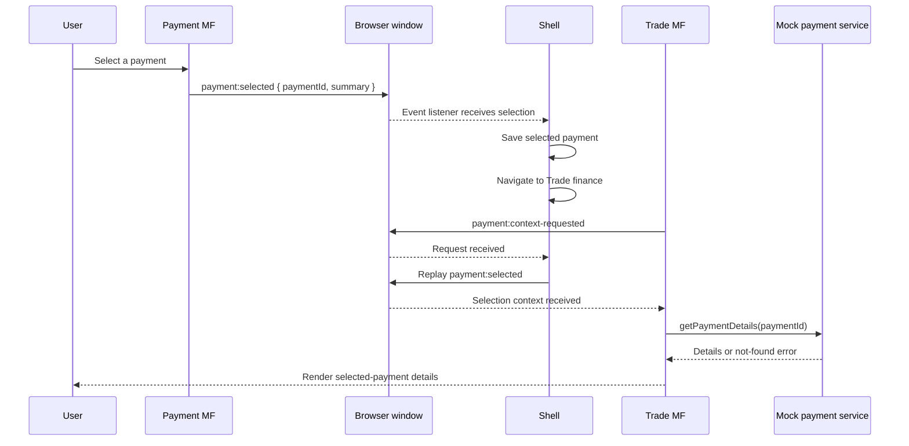

<div align="center">

# ✨ TradeFlow — Trade Finance Workspace

**A multi-framework microfrontend demo with OIDC authentication, event-driven UI coordination, and a mock payment-details service.**


*Explore the workspace, select a payment, jump to its trade details, and sign in through TSCloak.*

</div>

---

## 🧭 Contents

- [Overview](#-overview)
- [Technology stack and tools](#-technology-stack-and-tools)
- [Architecture at a glance](#-architecture-at-a-glance)
- [MFE integration and federation approach](#-mfe-integration-and-federation-approach)
- [Applications and ports](#-applications-and-ports)
- [Quick start](#-quick-start)\n- [Install and build workflow](#-install-and-build-workflow)
- [Authentication with TSCloak](#-authentication-with-tscloak)
- [Logout and sign-in lifecycle](#-logout-and-sign-in-lifecycle)
- [Microfrontend communication](#-microfrontend-communication)
- [Payment-selection journey](#-payment-selection-journey)
- [Repository layout](#-repository-layout)
- [Security boundaries and current limitations](#-security-boundaries-and-current-limitations)
- [Troubleshooting](#-troubleshooting)

## 🎯 Overview

TradeFlow is a learning/demo application for exploring a **Shell + independently built microfrontends** approach for a Trade Finance workspace. The Shell owns top-level navigation, authentication gating, the sticky header, and the profile menu. Feature MFs own their screens. Shared browser-event contracts keep cross-MF communication explicit.

> [!IMPORTANT]
> This is a frontend demo. The data is illustrative, and the payment-details service is an in-memory mock—not a deployed HTTP API or a Spring Boot backend.

## 🧰 Technology stack and tools

<div align="center">


</div>

### Core technologies

| Area | Technology | How it is used |
|---|---|---|
| Application composition | React 18 + React Router 6 | Shell layout, route handling, navigation, profile menu, and authentication gating |
| MFE integration / runtime loading | Vite-built remote bundles + Web Components / Custom Elements | Shell loads separately built MFE assets at runtime; Angular and Vue modules are exposed as custom elements |
| Dashboard UI | React 18 | Overview dashboard and trade activity |
| Trade UI | React 18 + TypeScript | Trade workspace and selected-payment details |
| Payments UI | Angular 19 + Angular Elements | Payment module exposed as a custom element |
| Analytics UI | Vue 3 | Analytics module exposed as a custom element |
| Language and contracts | TypeScript 5.7 | Typed UI code and shared event payload definitions |
| Build and local serving | Vite 6, Angular CLI/build, TypeScript compiler | Builds and serves the independently built modules |
| Workspace/package management | npm workspaces | Manages apps and the shared `@trade-finance/mf-contracts` package from the repository root |
| Browser communication | `window` + `CustomEvent` | Publishes and listens for events such as `payment:selected` |
| Authentication | TSCloak + OIDC Authorization Code Flow with PKCE | Browser sign-in, callback handling, user claims, and logout redirect |
| OIDC client library | `oidc-client-ts` | Implements browser-side OIDC protocol interactions |
| Payment data | TypeScript in-memory mock service | Simulates loading payment details; no HTTP backend is connected yet |
| Diagrams and docs | Markdown + Mermaid + Shields.io badges | Documents architecture and sequence flows in the README |

### Developer tools

- **Node.js and npm** — install dependencies and run the workspace scripts.
- **Browser DevTools** — inspect redirects, OIDC callback errors, browser storage, custom events, and network requests.
- **Mermaid-compatible Markdown viewer** — render the architecture and sequence diagrams (for example, GitHub).
- **TSCloak web console** — configure the public SPA client, redirect URIs, and allowed scopes.

> **Stack boundary:** this repository currently contains frontend applications and an in-memory mock service. Spring Boot, a database, automated test tooling, and production observability are not wired into this demo yet.

## 🏗️ Architecture at a glance



## 🧩 MFE integration and federation approach

**This project does not currently use Webpack Module Federation or a configured Vite Module Federation plugin.** It uses separately built Vite assets and browser-native Web Components / Custom Elements for the Angular Payment MF and Vue Analytics MF. The Shell loads the feature assets at runtime and coordinates navigation and events.



### What this means

- **Build-time:** each application is built with its own tooling/configuration (Vite and the relevant framework build setup).
- **Runtime composition:** the Shell loads the built feature assets; Angular and Vue features register custom elements that the Shell can render.
- **Cross-MFE communication:** shared TypeScript contracts document browser `CustomEvent` names and payloads. Events are available to modules loaded in the same browser page.
- **Not Module Federation:** we do not currently configure remote module exposure/consumption or shared dependency negotiation through `ModuleFederationPlugin` or `@module-federation/vite`.

If the project later adopts **Module Federation**, the architecture documentation should be updated to name the chosen implementation and document remote-entry URLs, exposed modules, shared dependencies, version compatibility, and fallback behavior. Do not describe the current setup as “Webpack Module Federation.”

### Design principles

- **Shell owns composition:** navigation, route protection, header, and profile menu live in one place.
- **Feature ownership stays local:** each MF owns its feature UI and can be built separately.
- **Contracts over imports:** browser events provide a small, explicit communication surface.
- **Identity is centralized:** the Shell uses OIDC; feature modules are shown behind the authenticated workspace.
- **Backend is a future boundary:** business data and authorization must move to secured APIs for production.

## 🧩 Applications and ports

| Application | Local URL | Responsibility |
|---|---|---|
| **Shell** | `http://localhost:5000` | App composition, navigation, OIDC, sticky header, profile menu |
| Dashboard MF | `http://localhost:5001` | Overview cards and recent trade activity |
| Trade MF | `http://localhost:5002` | Trade register and selected-payment details |
| Payment MF | `http://localhost:5003` | Payment list and payment selection |
| Analytics MF | `http://localhost:5004` | Trade analytics view |
| Shared contracts | workspace package | Event names, payload types, event helper |

The Shell loads feature modules at runtime. The root `dev` command builds the feature bundles first and then starts the Shell and MF preview servers together.

## 🚀 Quick start

### Prerequisites

- Node.js and npm (use a current LTS release)
- A TSCloak client configured for local development
- Network access to `https://tscloak.onrender.com` for login/logout

### Run the workspace

From the repository root:

```bash
npm install
npm run build
npm run dev
```

## ⚙️ Install and build workflow\n\n### What happens during `npm install`?

The root `package.json` declares the workspace patterns `apps/*` and `packages/*`. npm discovers each workspace and links local workspace packages to applications that declare them as dependencies. This means `@trade-finance/mf-contracts` can be consumed locally without publishing it to the npm registry.



> **Important:** npm only makes a workspace package available to an app when that app declares it as a dependency. The root workspace pattern discovers the package; it does not automatically make every app depend on it.

### Where does `packages/` fit during the build?

`packages/mf-contracts` is shared source code and contract definitions—not a separately running application. During an app's build, its build tooling resolves imports from `@trade-finance/mf-contracts`. Depending on the package exports and build configuration, the helper code is bundled into the consuming app, while TypeScript declarations provide compile-time type checking. The exact bundle behavior is controlled by the current package and app build configurations.



The key distinction is:

- **Install time:** npm discovers and links local workspaces and installs external dependencies.
- **Build time:** each application resolves the shared package imports and produces its own build output.
- **Runtime:** the browser events carry messages between MFEs in the same page. `packages/mf-contracts` is not a runtime event broker and this setup is not Module Federation.

Open **<http://localhost:5000>**. The Shell redirects unauthenticated users to TSCloak. Once authenticated, you can navigate between Overview, Trade finance, Payments, and Trade analytics.

> 💡 `npm run dev` builds the remote MFs before starting their preview servers. If you change an MF and it does not appear to update, rebuild/restart the workspace.

## 🔐 Authentication with TSCloak

The Shell is a browser-based OIDC client using **Authorization Code Flow with PKCE (`S256`)**. The requested working scopes are `openid profile email`.

### OIDC sequence



### Register/configure the public SPA client

In TSCloak, the browser client must be registered as a **public SPA**. Do not embed a client secret in frontend code.

| Setting | Value |
|---|---|
| Issuer / provider | `https://tscloak.onrender.com` |
| Client type | Public browser SPA |
| Redirect URI | `http://localhost:5000/auth/callback` |
| Post-logout URI | `http://localhost:5000/signed-out` |
| Allowed web origin | `http://localhost:5000` |
| Flow | Authorization Code + PKCE (`S256`) |
| Working scopes | `openid profile email` |

> **Scope note:** The `roles` scope previously returned `invalid_scope` from this IdP, so the app should continue using the working standard scopes until TSCloak's role-scope assignment is corrected. Roles may be exposed as claims separately, depending on the IdP configuration.

### Client configuration

1. Copy `apps/shell/.env.example` to `apps/shell/.env` if needed.
2. Set the client ID issued for the registered TSCloak application:

   ```dotenv
   VITE_OIDC_CLIENT_ID=your-registered-client-id
   ```

3. Restart the dev server after editing `.env`.

A client ID is public configuration, but it must match the IdP registration. Never place a client secret, password, access token, or ID token in `.env`, source control, or screenshots.

## 🚪 Logout and sign-in lifecycle



- The profile menu in the sticky top header offers **Profile details** and **Sign out**.
- `/profile` displays the available signed-in user claims; the Dashboard itself does not host a profile card.
- `/signed-out` is a public route and should not automatically initiate a new login.
- Logout must be one uninterrupted navigation. TSCloak—not the `localhost` application—owns and must expire its own `_session` cookie.
- The post-logout redirect URI must be allowed by the IdP. If the IdP cookie remains, inspect the `/session/end` response and `Set-Cookie` header in DevTools; the frontend cannot delete a cookie owned by another origin.

## 🔁 Microfrontend communication

The `@trade-finance/mf-contracts` workspace package defines shared event names and payload types. Events are dispatched on the browser `window` object, so this pattern applies to MFEs loaded in the **same browser page**.

### Event map

| Event | Publisher / consumer | Purpose in this demo |
|---|---|---|
| `payment:selected` | Payment MF → Shell; Shell can replay to Trade MF | Announces the selected payment summary/ID |
| `payment:context-requested` | Trade MF → Shell | Trade MF asks for the current selection after it mounts |
| `mf:ready` | Feature MF → Shell (where emitted) | Reports that a module is ready/registered |
| `mf:error` | Shared contract | Contract for module error reporting; handling may need extending |
| `mf:navigate` | Shared contract / Shell listener | Contract for navigation requests; producers may need adding where required |

### Event sequence



**Important:** browser events are not a message broker and do not persist messages. The Shell keeps demo selection state in memory and replays it when Trade MF requests the context. This is suitable for a learning demo; production data must be retrieved from an API.

### How applications reference the shared contracts package

The repository uses **npm workspaces** to make the shared package available to applications without publishing it to a package registry. The root `package.json` declares both `apps/*` and `packages/*` as workspaces, so npm recognizes `packages/mf-contracts` as the local package `@trade-finance/mf-contracts`.

For an MFE to use the package, it declares the dependency in its own `package.json`:

```json
{
  "dependencies": {
    "@trade-finance/mf-contracts": "*"
  }
}
```

Then application code imports the shared helper and types using the package name:

```ts
import { emitMfEvent } from '@trade-finance/mf-contracts';
import type { PaymentSelectedDetail } from '@trade-finance/mf-contracts';

emitMfEvent('payment:selected', {
  paymentId: 'PAY-1001',
  beneficiary: 'Example beneficiary',
  amount: 'USD 1,250.00',
  status: 'Processing',
});
```

The example payload is illustrative; use the `PaymentSelectedDetail` definition in `packages/mf-contracts/src/index.d.ts` as the source of truth for the allowed fields and values. TypeScript checks the event name and payload shape at build time.

### What happens at build time vs. runtime?

1. **Install/workspace resolution:** `npm install` links the local workspace package for apps that declare it as a dependency. No separate registry publish is required.
2. **Build time:** Vite or the relevant application build tooling resolves imports from `@trade-finance/mf-contracts` and bundles the helper into the consuming application as configured by that build. Shared TypeScript declarations help keep event names and payloads consistent.
3. **Runtime communication:** the `emitMfEvent` helper calls `window.dispatchEvent(new CustomEvent(name, { detail }))`. The consumer listens for the same event on `window` and reads `event.detail`. The package provides the contract and helper; it is **not** a runtime event broker.

For example, Payment MF emits `payment:selected`, the Shell listens and stores the selection, and Trade MF can request/re-receive the selected payment context after it mounts. This works because the modules run in the same browser page.

> **Architect interview summary:** “We use npm workspaces to manage a shared TypeScript contracts package. Each MFE declares it as a dependency and imports common event types and the event helper. This keeps event names and payloads consistent at build time, while actual cross-MFE communication happens at runtime through browser `CustomEvent`s on `window`. This is workspace package sharing, not Module Federation.”

## 💳 Payment-selection journey

1. Open **Payments** and select a payment row.
2. Payment MF emits `payment:selected`.
3. The Shell stores the selection and navigates automatically to **Trade finance**.
4. Trade MF requests the current selection after mounting.
5. The Shell replays the selection event.
6. Trade MF calls `getPaymentDetails(paymentId)` in `apps/trade-mf/src/api/mockPayments.ts`.
7. The mock service simulates latency and returns sample details or a not-found error.

This function is an in-memory TypeScript service, **not** a real HTTP endpoint. When a Spring Boot API is available, replace it with a `fetch`/HTTP client call while keeping the feature UI and event contract stable.

## 📁 Repository layout

```text
trade-finance-mfe/
├── apps/
│   ├── shell/          # Composition, routes, OIDC, header and profile menu
│   ├── dashboard-mf/   # Overview dashboard
│   ├── trade-mf/       # Trade register and mock payment-details call
│   ├── payment-mf/     # Payment list and selection event
│   └── analytics-mf/   # Analytics module
├── packages/
│   └── mf-contracts/   # Shared browser-event contracts
├── package.json        # npm workspaces + root scripts
└── README.md
```

## 🛡️ Security boundaries and current limitations

- OIDC protects the Shell's browser UI; it does **not** secure a future backend automatically.
- A Spring Boot API must independently validate access-token signature, issuer, audience, expiry, and required permissions/roles.
- Frontend route hiding is not authorization enforcement.
- The current payment data is mock/in-memory data and must not be used for real financial operations.
- Role-based route restrictions are not enabled in this initial integration.
- Browser events work only within the same page context and are not suitable for server-to-server communication.
- The OIDC/logout behavior depends on TSCloak's client configuration and supported end-session behavior; verify cookie expiration in the browser during testing.

## 🧰 Troubleshooting

| Symptom | What to check |
|---|---|
| Login returns `invalid_scope` | Use `openid profile email`; verify additional scopes are assigned/allowed by TSCloak before requesting them. |
| Login loops or callback reports state mismatch | Start a fresh login from the app; keep the origin exactly `http://localhost:5000`; inspect the callback and browser console. |
| Logout request is canceled | Inspect Network → `/session/end` → Initiator. Ensure the Shell does not launch a new login while logout is in progress. |
| TSCloak `_session` cookie remains | Inspect `/session/end` response and `Set-Cookie`; only TSCloak can expire its own cookie. |
| Trade MF has no selected payment | Select a payment first; check the `payment:selected` and `payment:context-requested` events in DevTools. |
| A remote MF is blank or stale | Check its preview port, build output, browser console, and whether the root `dev` command completed the remote build. |
| `.env` change has no effect | Restart the dev server and verify `VITE_OIDC_CLIENT_ID` matches the registered client. |

---

<div align="center">

**TradeFlow · Learning through architecture**

*Microfrontends · OIDC · Browser events · Mock API boundary*

</div>
